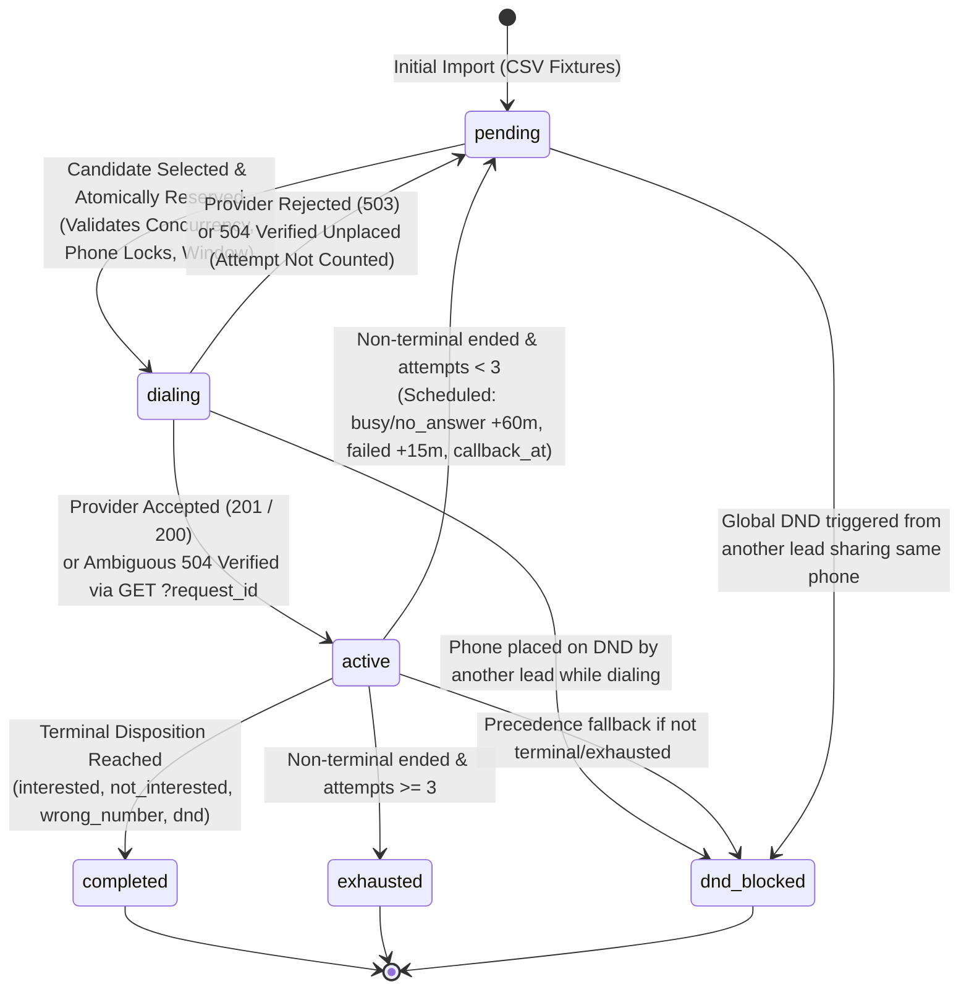
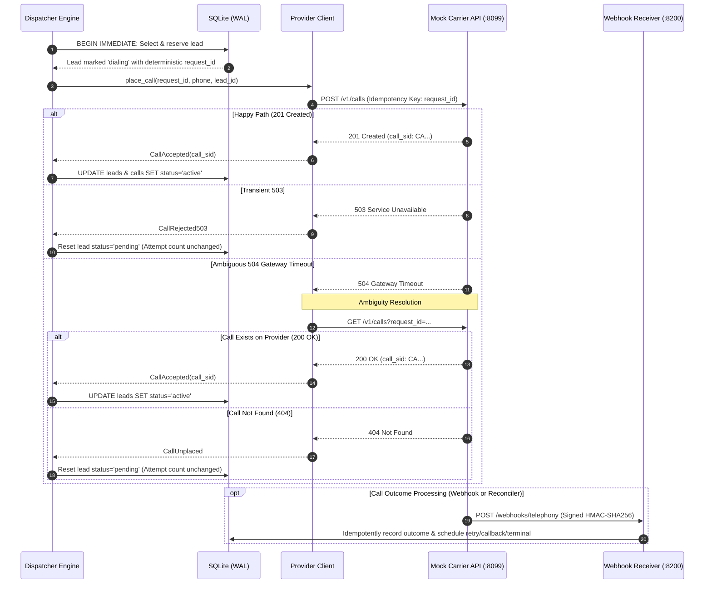

# Durable Campaign Dispatcher (Workflow Engine)

<div align="center">


-success?style=for-the-badge&logo=shield&logoColor=white)


</div>

---

## Candidate
- **Name:** Mayank
- **Assignment chosen:** B (Workflow - Durable Campaign Dispatcher)
- **Time spent (honest estimate):** 6h

---

## How to run

### 1. Environment Setup
```bash
cd sde-assignment-junior-2026

# Create and activate virtual environment
python -m venv .venv

# On Windows:
.venv\Scripts\activate
# On Linux / macOS:
# source .venv/bin/activate

# Install required dependencies
pip install -r requirements.txt
```

### 2. Run Test Suite
Pure unit tests verifying window math, regulatory clamping, next window openings, retry policies, callback priority, and atomic concurrency:
```bash
python -m pytest solution/tests/ -v
```

### 3. Run Mock Telephony Provider & Dispatcher Manually
In terminal 1 (start mock carrier API with clock speed 1200x and full chaos failure injection):
```bash
python -m mock_telephony --speed 1200 --seed 7 --failure-scale 1.0
```

In terminal 2 (start dispatcher service):
```bash
python -m solution.main
```

### 4. Or Run Full Automated Chaos & Crash Verification
Launches mock carrier, boots dispatcher, executes mid-run `kill -9` process crashes, resumes from SQLite, diffs output contract with `/admin/leads`, and verifies 0 violations:
```bash
python -m solution.verify_run --speed 1200 --seed 7 --failure-scale 1.0
```

---

## Architecture & System Design

The service is built as a **durable, crash-resilient workflow engine** centered around **SQLite with Write-Ahead Logging (`PRAGMA journal_mode=WAL`)** and strict transaction barriers (`BEGIN IMMEDIATE`). It guarantees that business rules R1–R9 are strictly enforced even across arbitrary process crashes, network partitions, dropped webhooks, and ambiguous 504 gateway timeouts.

```mermaid
flowchart TD
    subgraph Storage ["Durable State Store (SQLite WAL)"]
        DB[(dispatcher.db)]
        DND[(Global DND Numbers)]
    end

    subgraph DispatcherService ["Dispatcher Engine"]
        Clock[ProviderClock Local Calc]
        Scheduler[Scheduler & Window Math]
        Reconciler[Active Call Reconciler]
        Dialer[Concurrent Dialer Loop]
    end

    subgraph Telephony ["External Telephony Provider (:8099)"]
        API[Provider API POST /v1/calls]
        CarrierClock[GET /v1/clock]
        Report[/admin/report & /admin/leads]
    end

    subgraph WebhookIngestion ["FastAPI Webhook Server (:8200)"]
        Receiver[POST /webhooks/telephony]
        HMAC[HMAC-SHA256 Signature Validator]
    end

    %% Flow connections
    CarrierClock -->|One-time Sync| Clock
    Clock -.->|Simulated Now| Scheduler
    DB <-->|Atomic Reservation & Update| Scheduler
    Scheduler -->|Eligible Candidates| Dialer
    Dialer -->|Deterministic request_id| API
    API -->|Async Call Result Webhook| Receiver
    Receiver -->|Verify Secret| HMAC
    HMAC -->|Idempotent Update & Trigger Next Tier| DB
    Reconciler -->|Poll in-flight / Catch lost ~3%| API
    Reconciler -->|Sync Ended Calls| DB
    DB -->|Cascade Blocked Leads| DND
    DB -->|Output Contract| CSV[final_state.csv]
```

### Core Architecture Components:
1. **Clock Synchronization (`solution/clock.py`):**
   Reads `GET /v1/clock` once at startup and computes simulated time locally using `sim_now = sim_epoch + (time.time() - real_epoch) * speed`. Avoids clock polling bottlenecks and supports pluggable fake clocks for deterministic testing.
2. **Scheduling Engine (`solution/scheduler.py`):**
   Pure functional time calculation logic. Computes intersections between campaign windows (`[start, end)` on permitted days) and the regulatory 09:00–21:00 IST window. Calculates next eligible times for retries (60 min for `busy`/`no_answer`, 15 min for `failed`) and enforces strict priority ordering (**Due Callbacks > Retries > Fresh leads**).
3. **Durable State Store & Reservation (`solution/db.py`):**
   Stores campaigns, leads, calls, and global DND numbers. Lead reservations occur within atomic transactions: candidate selection checks tenant concurrency limits, active phone collisions across campaigns, global DND lists, and window boundaries before immediately marking the lead `dialing` with a deterministic `request_id`.
4. **Resilient Telephony Client (`solution/provider_client.py`):**
   Async HTTP client interfacing with the mock provider:
   - `201 Created` / `200 OK`: Accepted; records `call_sid` and transitions lead to `active`.
   - `503 Service Unavailable`: Transient failure; releases lead back to `pending` without incrementing attempt count.
   - `504 Gateway Timeout`: Ambiguous outcome; immediately disambiguates by querying `GET /v1/calls?request_id=...`. If 200, call was placed; if 404, releases lead.
5. **Webhook Receiver & Ingestion (`solution/webhook_server.py`):**
   FastAPI HTTP server listening at `/webhooks/telephony`. Verifies raw request body HMAC-SHA256 signatures with `webhook_secret`. Ensures idempotent ingestion via primary keys and deduplication headers (`X-AU-Delivery-Id`).
6. **Active Call Reconciler (`solution/dispatcher.py`):**
   The mock telephony provider drops approximately 3% of webhooks. The reconciler runs every 0.5s, querying `GET /v1/calls/{call_sid}` for all in-flight calls to ensure no completed call is ever lost.
7. **Crash Recovery & Startup Re-hydration:**
   On startup or restart after `kill -9`, the dispatcher inspects any calls left in `dialing` or `active` states. It queries the provider API to determine their true state and syncs the database before resuming dispatch.

---

## Lead Lifecycle State Machine

A lead transitions through deterministic lifecycle states according to rules R1–R9:



- **`pending`**: Initial state loaded from CSV fixtures, or re-queued after non-terminal attempts.
- **`dialing`**: Candidate selected and atomically reserved in SQLite (`BEGIN IMMEDIATE`), locking tenant concurrency and the phone number.
- **`active`**: Provider accepted the call (`201 Created` or `200 OK`, or disambiguated `504` verified via `GET /v1/calls?request_id=...`).
- **`completed`**: Reached a terminal disposition (`interested`, `not_interested`, `wrong_number`, or `dnd`).
- **`exhausted`**: Call ended with a non-terminal status/disposition and all `max_attempts` (3) have been used.
- **`dnd_blocked`**: Phone number was placed on global DND by another lead; non-terminal/non-exhausted lead is permanently blocked.
- **Transient Reversals:** If provider rejects with `503` or unplaced `504`, the lead transitions from `dialing` directly back to `pending` without incrementing its attempt counter.

---

## At-Most-Once Dialing & Ambiguity Resolution

To ensure we never double-dial a customer even under high chaos or crashes, every dial follows strict idempotency and disambiguation:



### Guarantees Enforced:
1. **Deterministic Request IDs:** Every call attempt generates a deterministic idempotency key:
   `req_{campaign_id}_{lead_id}_{attempt_no}`. Even if a network drop or crash occurs during request transmission, retrying with the same `request_id` returns `200 OK` without creating duplicate calls.
2. **Atomic In-Database Reservation:** Before sending the HTTP request, the candidate lead is marked `dialing` and phone number locked inside a SQLite `BEGIN IMMEDIATE` transaction. No other coroutine or process can pick the same lead or phone number.
3. **Ambiguity Resolution:** An HTTP 504 never triggers an immediate blind retry with a new key. The service queries `GET /v1/calls?request_id={request_id}` to confirm whether the provider accepted the call.
4. **Crash Safety:** If the service crashes while a call is `dialing`, startup recovery checks the provider API. If the call was registered, it marks it `active`; if not found, it safely resets the lead back to `pending`.

---

## Decisions & Assumptions

| Decision | Why | Alternative considered |
|---|---|---|
| **SQLite with WAL mode (`PRAGMA journal_mode=WAL`) instead of Temporal** | SQLite provides zero external dependencies, robust ACID durability, sub-millisecond atomic transactions with `BEGIN IMMEDIATE`, and total independence from real-world wall clocks (allowing 600x–1200x simulation speed). | Temporal: Requires a running Temporal server/cluster and mapping the mock provider's accelerated simulated clock into Temporal workflow timers introduces timer scaling complexity. |
| **Dynamic clock-speed safety buffer before calling** | At 1200x speed, 1 real second equals 20 simulated minutes. A 0.2s network transit time advances simulated time by 4 minutes. A dynamic buffer `max(180s, speed * 2.0s)` ensures calls reaching the carrier right before window close are rescheduled instead of violating the window. | Static 120s buffer: Insufficient at 1200x speed because network latency variance across concurrent dials would breach the closing edge. |
| **Strict Precedence Enforcement (`completed` > `exhausted` > `dnd_blocked`)** | Per Rule R9, terminal states take strict precedence. If a lead reached terminal disposition or exhausted its 3 attempts, a subsequent DND on another lead sharing the same phone does not alter its finalized state. | Downgrading all leads sharing a phone to `dnd_blocked` regardless of history. |
| **Dual Webhook & Reconciler Ingestion** | The provider drops ~3% of completion webhooks. The reconciler polls `GET /v1/calls/{call_sid}` periodically to ensure zero stalled leads, while the webhook server processes events in real time. | Webhook-only (leads get permanently stuck on dropped webhooks) or polling-only (unnecessary API load and higher latency). |
| **Rescheduling callback if requested outside window** | Rule R6 states: "if it falls outside the window, at the next window opening". The scheduler calculates the combined intersection of campaign window and regulatory window and clamps the dial time to the next opening. | Dropping the callback or calling outside regulatory hours. |

---

## Failure Modes Considered & Handled

- **Process Crash (`kill -9`) Mid-Dial:**
  - *Risk:* A process is killed after marking a lead `dialing` but before saving the response.
  - *Handling:* On restart, `startup_recovery()` scans all calls in `dialing` or `active` states and queries `GET /v1/calls?request_id=...` or `GET /v1/calls/{call_sid}` on the provider API to synchronize actual state.
- **Ambiguous HTTP 504 Gateway Timeout:**
  - *Risk:* Carrier placed the call but timed out sending the response.
  - *Handling:* Provider client queries `GET /v1/calls?request_id={request_id}`. If 200, the call is linked and tracked; if 404, the lead attempt is not incremented and reset to `pending`.
- **Transient HTTP 503 Service Unavailable:**
  - *Risk:* Carrier temporarily overloaded; counting this as an attempt would unfairly penalize leads (Rule R4).
  - *Handling:* Lead is kept at current attempt number and reset to `pending` with a short 2-simulated-second backoff.
- **Duplicate Webhook Delivery:**
  - *Risk:* Processing a completed webhook twice could corrupt attempt counters or schedule redundant retries.
  - *Handling:* Handled idempotently using unique database indices on `call_sid` and recording outcome once.
- **Dropped Webhooks (~3% packet loss):**
  - *Risk:* Leads remain stuck in `active` forever.
  - *Handling:* Active call reconciler periodically checks all in-flight calls against `GET /v1/calls/{call_sid}` and marks ended calls appropriately.
- **Clock Drift & Network Latency at 1200x Speed:**
  - *Risk:* Dispatch decision made at 18:59:50 IST reaches carrier at 19:00:10 IST, triggering a 422 window violation.
  - *Handling:* Candidate selection and pre-dial hooks enforce a speed-proportional safety buffer, deferring edge calls to the next window opening.
- **Global DND Race Condition:**
  - *Risk:* Lead A requests DND while Lead B with the same phone is queued for dialing.
  - *Handling:* Insertion into `dnd_numbers` immediately updates all matching non-terminal leads across all campaigns to `dnd_blocked` within the same transaction.

---

## Testing

```
============================= 21 passed in 1.87s =============================
```

- **Scheduling & Window Maths Unit Tests (`solution/tests/test_scheduler.py`):**
  - Tested calling window evaluation (`[start, end)` boundary checks, allowed days).
  - Tested regulatory 09:00–21:00 IST window clamping.
  - Tested next window opening calculations across midnight and across weekend non-calling days.
  - Tested retry delays (60 minutes for `no_answer`/`busy`, 15 minutes for `failed`).
  - Tested callback scheduling and window deferrals.
- **Clock Model Tests (`solution/tests/test_clock.py`):**
  - Tested simulated time calculation without polling, speed conversion, and simulated sleep.
- **State Machine & Lifecycle Tests (`solution/tests/test_state_machine.py`):**
  - Tested transitions (`pending` -> `dialing` -> `active` -> `completed` / `exhausted`).
  - Tested terminal disposition handling.
- **DND & Concurrency Safety Tests (`solution/tests/test_dnd_and_concurrency.py`):**
  - Tested cross-campaign global DND cascade and rule R9 precedence (`completed` > `exhausted` > `dnd_blocked`).
  - Tested tenant concurrency limit enforcement and same-phone mutual exclusion.
- **Idempotency & Webhook Security Tests (`solution/tests/test_idempotency_and_webhooks.py`):**
  - Tested HMAC-SHA256 signature verification and rejection of invalid signatures.
  - Tested deduplication of redelivered webhooks.
- **End-to-End Chaos Verification (`solution/verify_run.py`):**
  - Executed against mock telephony provider at 1200x speed with failure scale 1.0 (chaos injected) and simulated `kill -9` process crashes mid-flight. Verified 0 violations in `/admin/report` and exact diffing against `/admin/leads`.

---

## Verification Results

### Summary from Full Run with Injected Chaos (`--failure-scale 1.0`, `--speed 1200`, with simulated mid-run crash):
```
----------------------------------------------------------------------
ADMIN REPORT:
  Total calls: 407
  Calls active: 0
  Calls by status: {'completed': 222, 'busy': 52, 'failed': 25, 'no_answer': 108}
  VIOLATION COUNT: 0
  Violations by type: {}
  Max concurrency seen: {'acme_insurance': 4, 'zen_retail': 3}
  Callback lateness (min): {'count': 64, 'p50': 100.6, 'p90': 1026.8, 'max': 3923.9}
  Webhooks stats: {'delivered': 433, 'duplicates': 35, 'lost': 9}
----------------------------------------------------------------------
Diffing final_state.csv against provider /admin/leads:
100% MATCH! All 200 leads match provider records exactly.

>>> ALL CHECKS PASSED: 0 VIOLATIONS & 100% OUTPUT MATCH! <<<
```

- **Violation Count:** **`0`** (zero window breaches, zero concurrency limit breaches, zero DND violations, zero duplicate active dials).
- **Correctness:** **100% exact match** across all 200 leads in `final_state.csv` compared to `/admin/leads`.
- **Resilience:** Handled 503s, ambiguous 504s, 35 duplicate webhooks, 9 lost webhooks, and process crash/restart without losing or corrupting any lead.

---

## If I Had Another Day

1. **Temporal Implementation:** Build a reference implementation using the `temporalio` Python SDK with workflow activities for dialing and signal handlers for webhooks, comparing its event history model with SQLite WAL.
2. **Horizontal Multi-Dispatcher Coordination:** Implement distributed row locking (`SELECT FOR UPDATE SKIP LOCKED` on PostgreSQL) to run multiple dispatcher worker instances concurrently across separate nodes.
3. **Observability & Real-time Metrics:** Add OpenTelemetry tracing and Prometheus metrics tracking per-campaign throughput, latencies, retry distribution, and a real-time web dashboard.
4. **Callback Lateness Optimization:** Introduce a priority lookahead scheduler that prioritizes callbacks whose windows are narrow over generic fresh leads to drive callback lateness down towards 0.
